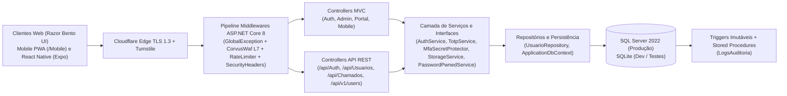

# Arquitetura de Software — CorvuxIAM (`CorvusIAM`)

A solução aplica separação de responsabilidades em camadas, orientação a objetos (abstração por interfaces em `CorvusIAM.Interfaces`, encapsulamento em serviços e DTOs, herança em `SqlServerDbContext`/`SqliteDbContext : ApplicationDbContext` e polimorfismo via Injeção de Dependência nativa do ASP.NET Core 8) e autenticação híbrida (`CookiesAndJwt`).
