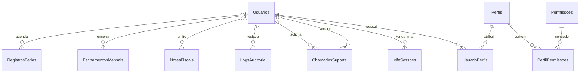

# Modelo Entidade-Relacionamento (MER) — CorvuxIAM (`CorvusIAMDb`)

O script Transact-SQL consolidado de instalação limpa (contemplando `CREATE DATABASE`, as 16 tabelas de domínio normalizadas em 3FN, chaves primárias e estrangeiras, índices filtrados e de cobertura, função escalar `fn_CalcularScoreRiscoUsuario`, 4 views analíticas, 5 triggers e 12 stored procedures) encontra-se unificado em `CorvusIAM/DatabaseScript.sql`.
