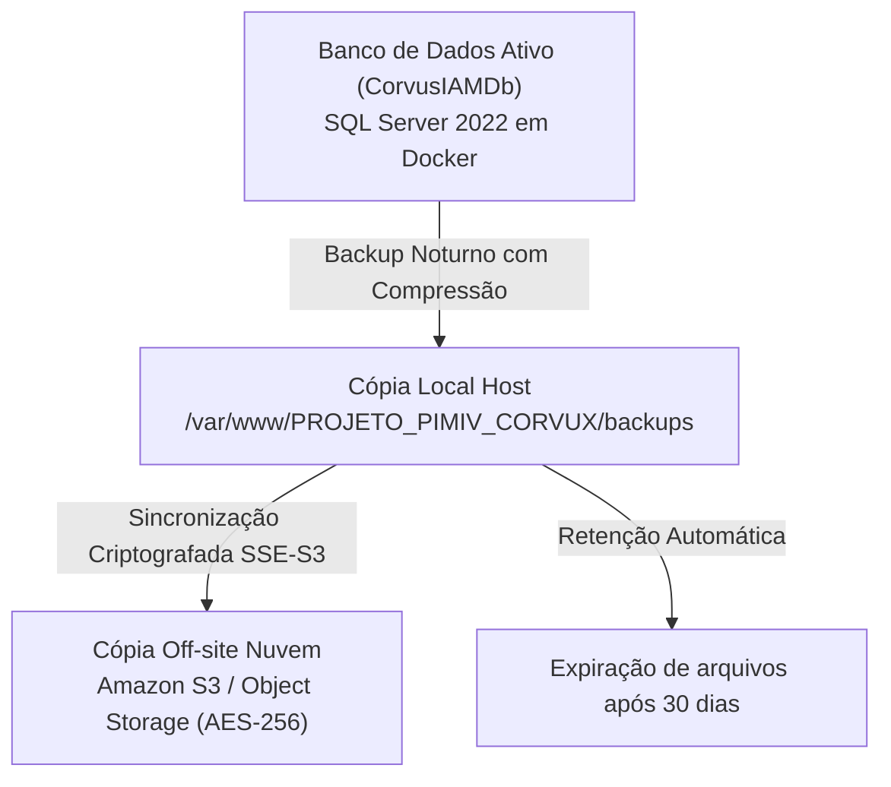

# Política de Backup, Recuperação de Desastres e Custos Operacionais
## Projeto Integrado Multidisciplinar IV (PIM IV) — UNIP
### Sistema: CorvuxIAM — Gestão Corporativa de Identidades e Acessos

---

## 1. 🎯 Objetivo e Escopo

Esta política estabelece as diretrizes formais para a salvaguarda, retenção, integridade e restauração dos dados da plataforma **CorvuxIAM**, garantindo conformidade com as normas **ABNT**, **LGPD (Lei Geral de Proteção de Dados - Lei nº 13.709/2018)** e padrões internacionais de segurança da informação (**ISO/IEC 27001** e **ISO/IEC 27031**).

A política aplica-se a todas as informações corporativas, credenciais criptografadas, perfis de acesso, políticas organizacionais e trilhas imutáveis de auditoria (*Audit Logs*).

---

## 2. ⏱️ Indicadores de Continuidade de Negócios (RPO e RTO)

| Indicador | Sigla | Definição no CorvuxIAM | Meta Operacional |
| :--- | :---: | :--- | :---: |
| **Recovery Point Objective** | **RPO** | Tolerância máxima aceitável de perda de dados entre o último backup e o momento de uma falha ou incidente. | **24 Horas** (Snapshots completos diários) / **0 Horas** para eventos em logs locais de contêiner. |
| **Recovery Time Objective** | **RTO** | Tempo máximo tolerado para recuperar e restabelecer o funcionamento completo do sistema e do banco após um incidente. | **< 30 Minutos** (Restauração automatizada via contêiner Docker). |

---

## 3. 🛡️ Estratégia de Salvaguarda 3-2-1

Para mitigar riscos de ransomware, falhas de hardware ou corrupção de sistema operacional, o CorvuxIAM adota a arquitetura de proteção recomendada internacionalmente:



1. **3 Cópias dos Dados:** Banco operacional ativo, arquivo de despejo local `.bak` no disco NVMe do servidor e cópia remota em nuvem.
2. **2 Mídias Distintas:** Armazenamento em bloco SSD NVMe de alta performance (VPS Hostinger) e armazenamento em nuvem de objetos (Amazon S3 Standard-IA / Glacier).
3. **1 Cópia Off-Site:** Localizada fora do data center primário da VPS para sobrevivência a incidentes físicos graves.

---

## 4. 📅 Rotina e Frequência dos Backups

| Tipo de Backup | Frequência | Horário de Execução | Compressão | Verificação | Retenção |
| :--- | :---: | :---: | :---: | :---: | :---: |
| **Full (Completo)** | Diária | 02:00 BRT (05:00 UTC) | Habilitada (`COMPRESSION`) | `RESTORE VERIFYONLY` | 30 Dias |
| **Diferencial / Logs** | Sob Demanda / Semanal | A critério de janela técnica | Habilitada | Automática | 14 Dias |
| **Arquivamento Frio** | Mensal | 1º dia do mês | GZIP + SSE-S3 | Manual | 365 Dias (Compliance) |

---

## 5. 🤖 Scripts e Automação de Infraestrutura

O projeto possui scripts prontos e testados localizados no diretório `/scripts`:

1. **`scripts/backup-db.sh`:**
   - Realiza o `BACKUP DATABASE CorvusIAMDb` nativo com verificação de soma de integridade (`CHECKSUM`), compressão e expurgo de arquivos com mais de 30 dias.
   - Mapeado no Docker Compose via volume `./backups:/var/opt/mssql/backup`.
2. **`scripts/restore-db.sh`:**
   - Procedimento de contingência (*Disaster Recovery*).
   - Bloqueia novas conexões com `ALTER DATABASE ... SET SINGLE_USER WITH ROLLBACK IMMEDIATE`.
   - Executa `RESTORE DATABASE ... WITH REPLACE` e reabre em modo multiusuário em poucos minutos.
3. **`scripts/sync-backups-s3.sh`:**
   - Envio automático dos arquivos para o bucket **Amazon S3** (`s3://corvusiam-backups-corporate/sqlserver/`) usando criptografia em repouso AES-256 (SSE-S3).

### Configuração no Cron do Linux (VPS):
```bash
# Executar backup diário às 02:00 da madrugada
0 2 * * * cd /var/www/PROJETO_PIMIV_CORVUX && bash scripts/backup-db.sh >> /var/log/corvusiam-backup.log 2>&1
```

---

## 6. 💰 Estimativa de Custos Operacionais e TCO (Total Cost of Ownership)

O projeto foi desenhado sob os princípios de **eficiência de custos em TI** e **sustentabilidade econômica** (Etapa 2 do Manual do PIM IV), priorizando tecnologias open-source e infraestrutura sob demanda:

### Planilha de Custos Mensais:

| Componente | Provedor / Serviço | Configuração / Capacidade | Custo Estimado Mensal |
| :--- | :--- | :--- | :---: |
| **Servidor de Aplicação & BD** | Hostinger Cloud VPS 1 | 1 vCPU / 4 GB RAM / 50 GB NVMe SSD / Ubuntu 26.04 | **R$ 39,90** |
| **Domínio Oficial** | Registro.br / Hostinger | Domínio personalizado `corvuxiam.tech` (R$ 49,90/ano) | **R$ 4,15** |
| **Certificado SSL / TLS** | Let's Encrypt / Certbot | Certificado Criptográfico HTTPS Wildcard | **R$ 0,00** (Open Source) |
| **Camada de Aplicação Web** | Microsoft .NET 8 SDK | Runtime Linux Kestrel (Open Source) | **R$ 0,00** (Livre) |
| **Banco de Dados Relacional** | Microsoft SQL Server 2022 | Edição Express/Developer em Docker | **R$ 0,00** (Livre) |
| **Armazenamento Nuvem Off-site** | Amazon Web Services (AWS) | S3 Standard-IA (~10 GB de backups retidos) | **~ R$ 0,80** ($ 0,15 USD) |
| **Total Estimado Mensal:** | — | — | **~ R$ 44,85 / mês** |

> [!TIP]
> **Comparativo Corporativo:** Em contraste com soluções proprietárias de IAM (como Okta ou Ping Identity, que custam entre R$ 25,00 e R$ 45,00 *por usuário/mês*), o **CorvuxIAM** oferece custo operacional fixo de **menos de R$ 50,00 mensais para toda a organização**, viabilizando a transformação digital em pequenas e médias empresas.

---

## 7. 👥 Matriz de Responsabilidades (RACI)

| Atividade | Responsável (R) | Aprovador (A) | Consultado (C) | Informado (I) |
| :--- | :---: | :---: | :---: | :---: |
| Execução da Rotina de Backup | Administrador DevOps | Gestor de TI | Equipe de Infra | SecOps |
| Teste Periódico de Restauração | Administrador DevOps | DPO / Gestor de Segurança | Desenvolvedores | Auditoria |
| Gestão do Ciclo de Retenção e Descarte | Administrador DevOps | DPO (LGPD) | Jurídico / RH | Gestor de TI |
| Resposta a Incidentes de Perda de Dados | SecOps / DevOps | Comitê de Crise | Toda a Equipe | Diretoria |

---

© 2026 Grupo CorvuxIAM — Universidade Paulista (UNIP)
