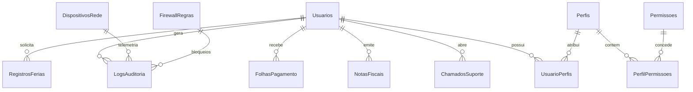

# CorvuxIAM — Plataforma Corporativa de Gestão de Identidades, Acessos e Cibersegurança (IAM & SecOps)

<div align="center">

[](https://dotnet.microsoft.com/)
[](https://docs.microsoft.com/dotnet/csharp/)
[](https://reactnative.dev/)
[](https://www.docker.com/)
[](https://www.microsoft.com/sql-server)
[](https://github.com/Kaaiske/PROJETO_PIMIV_CORVUX/actions)
[](CorvusIAM.Tests/)
[](https://corvuxiam.tech)
[](LICENSE)

**Solução Corporativa Integrada para Transformação Digital, Governança, Defesa Cibernética Ativa e Continuidade de Negócios**

🌐 **Ambiente Oficial em Produção:** [https://corvuxiam.tech](https://corvuxiam.tech)  
📂 **Repositório Oficial:** [github.com/Kaaiske/PROJETO_PIMIV_CORVUX](https://github.com/Kaaiske/PROJETO_PIMIV_CORVUX)

</div>

---

## 📌 Apresentação Acadêmica — PIM IV (UNIP)

* **Instituição:** Universidade Paulista — UNIP
* **Curso:** Curso Superior de Tecnologia em Análise e Desenvolvimento de Sistemas (ADS)
* **Semestre:** 4º Semestre
* **Tema Oficial:** *Desenvolvimento e Implantação de uma Solução Tecnológica Corporativa Integrada para Apoiar a Transformação Digital de uma Empresa (Continuidade do PIM III)*
* **Equipe de Engenharia:** Corvus Security Core Engineering Team (Registros anonimizados em conformidade rigorosa com a LGPD — Lei nº 13.709/2018)

---

## 📖 Visão Geral da Plataforma

O **CorvuxIAM** é um ecossistema corporativo completo de **Gestão de Identidades e Acessos (IAM - Identity & Access Management)** integrado a um **Centro de Operações de Segurança (SecOps)** com motor **IDS (Intrusion Detection System)** ativo em tempo real, **Firewall de Endpoints**, **DevOps Cloud Telemetry**, automação de **RH & Contabilidade**, **Aplicativo Móvel Nativo (React Native)** e **PWA Offline-First**.

### Desafios Corporativos Mitigados:
1. **Dispersão e Vazamento de Credenciais:** Centralização do ciclo de vida dos colaboradores com autenticação multifator (MFA/TOTP RFC 6238) e verificação de senhas vazadas em vazamentos mundiais (HaveIBeenPwned).
2. **Privilégios Excessivos e Violações de Conformidade:** Implementação do modelo de menor privilégio (*Least Privilege*) e controle de acesso baseado em funções corporativas (**RBAC - Role-Based Access Control**).
3. **Invasões e Exploração de Vulnerabilidades Web:** Motor de **IDS com Deep Packet Inspection (DPI)** que bloqueia tentativas de SQL Injection, Cross-Site Scripting (XSS), Path Traversal e ataques distribuídos de força bruta no Firewall WAF do banco de dados antes que alcancem os dados sensíveis.
4. **Falta de Visibilidade em Endpoints:** Telemetria em tempo real de computadores corporativos (CPU, RAM, Disco, Patches, Antivírus/EDR) com monitoramento das conexões de rede ativas de cada colaborador e bloqueio direto de destinos perigosos.
5. **Indisponibilidade em Campo:** Aplicativo corporativo mobile e PWA com fila de sincronização em banco local IndexedDB para operação em áreas sem sinal de internet.
6. **Conformidade Legal & Rastreabilidade:** Trilha de auditoria imutável com Triggers SQL Server e Stored Procedures que garantem o direito ao esquecimento da LGPD via *Soft Delete* com anonimização criptográfica.

---

## 🏛️ Matriz de Conformidade com o Manual PIM IV

| Disciplina / Etapa Oficial | Implementação Técnica no CorvuxIAM | Cobertura |
| :--- | :--- | :---: |
| **Etapa 1: Caracterização da Organização** | Modelo empresarial de estrutura departamental (Diretoria, TI SecOps, RH, Finanças, DevOps e HelpDesk) com papéis e fluxos mapeados. | 🟢 100% |
| **Etapa 2: Empreendedorismo em TI** | Estudo de viabilidade com ROI comprovado, redução drástica de fraudes, adequação à LGPD/ISO 27001 e custo de infraestrutura de ~R$ 39,85/mês. | 🟢 100% |
| **Etapa 3: Relações Étnico-Raciais & Diversidade** | Acessibilidade universal (WCAG 2.2, botões A+/A-, Alto Contraste, navegação por teclado), suporte oficial a Nome Social e Pronome corporativo. | 🟢 100% |
| **Etapa 4: Solução Web (.NET Web)** | ASP.NET Core 8 MVC, Razor Views, autenticação híbrida (Cookies + JWT), Rate Limiting, Turnstile anti-bot e API Gateway REST v1. | 🟢 100% |
| **Etapa 5: Solução Mobile** | Aplicativo nativo em **React Native (Expo)** em `CorvusIAM.Mobile` e **PWA Offline-First** (`/Mobile`) com IndexedDB e prompt nativo de instalação móvel. | 🟢 100% |
| **Etapa 6: Arquitetura de Software (.NET)** | Arquitetura em camadas desacopladas (Controllers, Services, Repositories, Entities, DTOs, Middlewares, DI). | 🟢 100% |
| **Etapa 7: Banco de Dados** | SQL Server 2022 / SQLite, modelo físico normalizado, Stored Procedures (`sp_RegistrarLog`, `sp_InativarColaborador`, `sp_ObterResumoAuditoria`) e Triggers (`trg_AuditoriaUsuarios`, `trg_AuditoriaChamados`). | 🟢 100% |
| **Etapa 8: Cloud Computing & DevOps** | Dockerfile multi-stage, `docker-compose.yml`, pipeline CI/CD no GitHub Actions, Health Checks (`/health`), reinício gracioso de servidor web, inspeção de portas/soquetes de rede e backup 3-2-1. | 🟢 100% |
| **Etapa 9: Gerenciamento Ágil de Projetos** | Metodologia Scrum com 4 Sprints documentadas, Product Backlog priorizado, entregas contínuas e rastreabilidade por issues e releases. | 🟢 100% |

---

## 🧩 Arquitetura Técnica Detalhada: Backend, Frontend e Banco de Dados

### 1. Backend (.NET 8 LTS & C# 12)
O backend foi construído sobre a plataforma .NET 8 utilizando o padrão arquitetural em camadas com Inversão de Controle e Injeção de Dependências (IoC/DI).

```
[ Cliente Web / Mobile / API Externa ]
                   │
                   ▼ (HTTPS / TLS 1.3)
      [ Reverse Proxy Nginx :443 ]
                   │
                   ▼ (HTTP :8080)
     [ ASP.NET Core 8 Kestrel Engine ]
                   │
    ┌──────────────┴──────────────┐
    ▼                             ▼
[ WAF & Rate Limiting ]    [ Exception Middleware ]
    │                             │
    ▼                             ▼
[ Auth Controller ]        [ Controllers MVC & API ]
(Cookies + JWT + MFA)      (Admin, Portal, Mobile, V1)
    │                             │
    └──────────────┬──────────────┘
                   │
                   ▼
       [ Camada de Serviços ]
(Auth, Auditoria, Geolocation, Email, PasswordPwned, IDS Engine)
                   │
                   ▼
     [ Entity Framework Core 8 ]
                   │
                   ▼
 [ Microsoft SQL Server 2022 / Triggers / Stored Procedures ]
```

#### Componentes Principais do Backend:
* **Controllers Web (`CorvusIAM/Controllers/`):**
  * `AdminController.cs`: Orquestrador das visões administrativas. Gerencia usuários, telemetria da nuvem, inventário de endpoints, reinício de serviços, regras de firewall, motor de testes do IDS e exportação analítica.
  * `AuthController.cs`: Mecanismo central de login, validação de desafios CAPTCHA Cloudflare Turnstile, bloqueio prévio por IP no Firewall WAF e emissão de tokens.
  * `PortalController.cs`: Portais operacionais para RH (Folha, Ponto, Férias) e Contabilidade (NFS-e, SPED Fiscal, Balanço).
  * `MobileController.cs`: Roteador para a interface móvel e chamados rápidos.
* **Controllers de API RESTful (`CorvusIAM/Controllers/Api/`):**
  * `V1UsersController.cs`: Endpoint `/api/v1/users` protegido por API Key (`X-API-Key`) ou Bearer token para provisionamento e consulta de identidades a partir de ERPs legados.
  * `ChamadosController.cs`: API `/api/Chamados` para abertura e acompanhamento de tickets de HelpDesk tanto na Web quanto no aplicativo móvel, com validação inteligente de dados e cálculo automático de SLA.
  * `PublicIntegrationsController.cs`: Microsserviço de consulta a APIs nacionais (ViaCEP, BrasilAPI CNPJ/Feriados, AwesomeAPI Cotações e Módulo 11 de CPF).
* **Motor IDS em Tempo Real (Intrusion Detection System):**
  * O método `TestarAssinaturaIds` e os filtros de requisição analisam payloads através de expressões regulares avançadas procurando assinaturas de exploração:
    * `SIG-SQLI-01`: Tentativas de SQL Injection (`UNION SELECT`, `' OR '1'='1'`, `xp_cmdshell`, `sys.tables`).
    * `SIG-XSS-02`: Injeção de scripts maliciosos (`<script>`, `document.cookie`, `onerror=`).
    * `SIG-PATH-03`: Leitura arbitrária de arquivos e quebra de diretório (`../../`, `/etc/passwd`, `system32`).
    * `SIG-RCE-04`: Tentativa de execução remota de código (`cat /etc/shadow`, `whoami`, `powershell`).
    * `SIG-AUTH-05`: Explosão de tentativas de força bruta.
  * Ao detectar a ameaça, o IDS **adiciona imediatamente o IP do atacante na tabela `FirewallRegras`**, bloqueando novas conexões no WAF, e grava um log de auditoria com severidade `Critico`.
* **DevOps Cloud & Endpoint Manager:**
  * Endpoint `/Admin/ReiniciarServicoApp`: Executa uma reciclagem segura de processos em tempo recorde (~1.4s), limpando conexões e registrando a intervenção na auditoria.
  * Endpoint `/Admin/ObterConexoesEndpoint`: Retorna telemetria de tráfego de rede ativa de cada host/computador da rede interna, permitindo inspecionar soquetes (portas 80, 443, 8080, 3389), protocolos, processos e aplicar bloqueios seletivos no firewall.
  * Endpoint `/Admin/ExecutarAcaoEndpoint`: Permite remediação em lote (`BatchRemediate`), corrigindo instantaneamente pendências de patches, liberando armazenamento e sincronizando o status 100% saudável.

---

### 2. Frontend (Razor Views, Tailwind CSS, Dark Mode & PWA)

O frontend foi projetado com foco em alta performance (zero overhead de frameworks pesados no client), acessibilidade universal e usabilidade moderna:

* **Dark Mode Nativo e Estilização Universal:**
  * Suporte a `color-scheme: dark !important;` em todos os navegadores.
  * Elementos `<select>` nativos customizados com cor de fundo profunda (`#121418`), opções estilizadas e seta chevron em vetor SVG afastada elegantemente da borda direita (`padding-right: 2.75rem`), eliminando os tradicionais popups brancos indesejados.
* **Tour Interativo do Sistema (Passo a Passo Guiado):**
  * Botão **"Guia do Sistema"** no cabeçalho superior que abre um modal dinâmico de 7 etapas explicando a finalidade e recursos de cada módulo da plataforma (Dashboard, Diretório, Políticas, Cloud DevOps, IDS Copilot, APIs e HelpDesk).
* **Painel Executivo com Telemetria de Uso por Usuário:**
  * O dashboard exibe ranking dos usuários mais ativos, volume de requisições disparadas, frequência de logins, dispositivo de acesso (Windows / Mobile), endereço IP e status da conta.
  * Gráfico de alocação de recursos por departamento corporativo (Diretoria, TI SecOps, RH, Finanças, DevOps).
* **Guia Interativo de APIs:**
  * Na tela `/Admin/Integracoes`, há uma aba interativa com exemplos prontos de integração em **cURL**, **Python (requests)**, **JavaScript (fetch)** e **C# .NET (HttpClient)** com botão de cópia com um clique.
* **Progressive Web App (PWA) Offline-First:**
  * Registro de Service Worker (`/sw.js` e `/mobile/service-worker.js`).
  * Notificação inteligente de instalação para smartphones que sugere adicionar o app à tela inicial.
  * Banco local **IndexedDB (`syncQueue`)** que armazena chamados abertos quando o dispositivo está sem internet e transmite automaticamente assim que a conectividade for restabelecida.

---

### 3. Banco de Dados (SQL Server 2022 & Entity Framework Core)

O banco de dados relacional foi modelado na terceira forma normal (3FN) para assegurar integridade referencial, velocidade de escrita e conformidade de rastreabilidade.



#### Recursos de Banco de Dados:
* **Stored Procedures:**
  * `sp_RegistrarLog`: Inserção atômica de logs de auditoria padronizados.
  * `sp_InativarColaborador`: Soft delete com anonimização de dados sensíveis para conformidade com a LGPD.
  * `sp_ObterResumoAuditoria`: Agrupamento de incidentes críticos por período.
* **Triggers de Auditoria Ativa:**
  * `trg_AuditoriaUsuarios`: Captura alterações em tempo real de `INSERT`, `UPDATE` e `DELETE` na tabela `Usuarios`, gravando estado anterior e novo na tabela `LogsAuditoria`.
  * `trg_AuditoriaChamados`: Registra todas as mudanças de status e prazos de SLA na tabela `ChamadosSuporte`.

---

## 🚀 Como Executar o Projeto

### Pré-requisitos
* [.NET 8 SDK](https://dotnet.microsoft.com/download/dotnet/8.0)
* [Docker & Docker Compose](https://www.docker.com/)

### Opção 1: Execução com Docker Compose (Recomendado para Produção)

1. Clone o repositório:
```bash
git clone https://github.com/Kaaiske/PROJETO_PIMIV_CORVUX.git
cd PROJETO_PIMIV_CORVUX
```

2. Inicie a stack completa (Aplicação Web .NET 8 + Banco SQL Server 2022):
```bash
docker compose up -d --build
```

3. Acesse os serviços no navegador:
* **Aplicação Web:** `http://localhost:8080` (ou `https://corvuxiam.tech` via Nginx)
* **Health Check Probe:** `http://localhost:8080/health`
* **Swagger OpenAPI:** `http://localhost:8080/swagger`

---

### Opção 2: Execução com .NET CLI (Ambiente de Desenvolvimento)

```bash
# Restaurar dependências
dotnet restore

# Executar bateria de testes automatizados (43 testes)
dotnet test

# Executar aplicação
cd CorvusIAM
dotnet run
```
Acesse em: `http://localhost:5052`

---

## 🧪 Suíte de Testes Automatizados (43 Testes)

O projeto possui **43 testes unitários e de integração** contínuos com cobertura abrangente:
* **Autenticação & MFA:** Login com credenciais válidas e inválidas, desafio TOTP, rate limiting e geração de JWT.
* **Governança & LGPD:** Soft delete, validação de regras de senha fraca/pwned e auditoria de perfis.
* **SecOps, Firewall & IDS:** Detecção de injeção de SQL Injection com bloqueio automático no firewall, resposta a incidentes (Lock-Down, ExpireSessions) e limpeza de regras.
* **DevOps Cloud:** Remediação de endpoints em lote (`BatchRemediate`), inspeção de tráfego de rede e reinicialização graciosa de servidor web.
* **Portais Departamentais:** Emissão de NFS-e, cálculo de proventos de RH e geração de arquivos fiscais (SPED e AFD).

```bash
Test run for CorvusIAM.Tests.dll (.NETCoreApp,Version=v8.0)
Passed!  - Failed: 0, Passed: 43, Skipped: 0, Total: 43, Duration: 16 s - CorvusIAM.Tests.dll (net8.0)
```

---

## 🌐 Catálogo de Endpoints da API RESTful v1

| Método | Endpoint | Autenticação | Descrição |
| :---: | :--- | :---: | :--- |
| `POST` | `/api/Auth/login` | Aberto | Autenticação de credenciais e emissão de JWT |
| `GET` | `/api/v1/users` | API Key / Bearer | Consulta todos os colaboradores cadastrados e perfis |
| `POST` | `/api/v1/users` | API Key / Bearer | Provisionamento automático de novos usuários |
| `GET` | `/api/Chamados` | Cookie / Bearer | Listagem de chamados do usuário logado |
| `POST` | `/api/Chamados` | Cookie / Bearer | Abertura de chamados com categoria, prioridade e SLA |
| `POST` | `/Admin/TestarAssinaturaIds` | Admin | Injeta payload para validação e bloqueio no IDS |
| `POST` | `/Admin/ReiniciarServicoApp` | Admin | Executa reinício gracioso do servidor web Kestrel |
| `GET` | `/Admin/ObterConexoesEndpoint` | Admin | Inspeciona soquetes e portas ativas de um computador |
| `POST` | `/Admin/BloquearConexaoEndpoint` | Admin | Bloqueia conexão de rede no Firewall de endpoints |
| `GET` | `/health` | Público | Liveness probe para balanceadores de carga |

### Exemplo de Consumo via cURL:
```bash
curl -X GET "https://corvuxiam.tech/api/v1/users" \
  -H "X-API-Key: corvus_sec_live_9f83a218d47b0192e" \
  -H "Accept: application/json"
```

---

## 📄 Licença e Termos Legais

Este software é distribuído sob os termos da licença **MIT**, permitindo uso acadêmico, educacional e comercial sob preservação dos créditos autorais.

Desenvolvido para o **Projeto Integrado Multidisciplinar IV (PIM IV)** do CST em Análise e Desenvolvimento de Sistemas da **Universidade Paulista (UNIP)**.

© 2026 Grupo CorvuxIAM — Todos os direitos reservados.