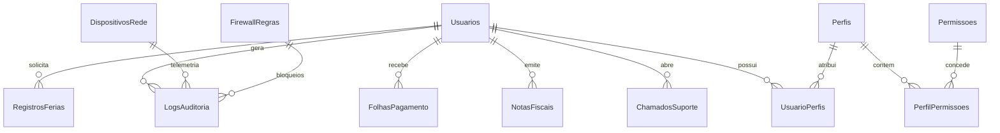

<div align="center">


# CorvuxIAM — Plataforma Corporativa de Gestão de Identidades, Acessos e Cibersegurança (IAM & SecOps)

[](https://dotnet.microsoft.com/)
[](https://docs.microsoft.com/dotnet/csharp/)
[](https://reactnative.dev/)
[](https://www.docker.com/)
[](https://www.microsoft.com/sql-server)
[](https://github.com/Kaaiske/PROJETO_PIMIV_CORVUX/actions)
[](CorvusIAM.Tests/)
[](https://corvuxiam.tech)
[](LICENSE)

**Solução Corporativa Integrada para Transformação Digital, Governança, Defesa Cibernética Ativa e Continuidade de Negócios**

🌐 **Ambiente Oficial em Produção:** [https://corvuxiam.tech](https://corvuxiam.tech)  
📂 **Repositório Oficial:** [github.com/Kaaiske/PROJETO_PIMIV_CORVUX](https://github.com/Kaaiske/PROJETO_PIMIV_CORVUX)

</div>

---

## 📌 Apresentação Acadêmica — PIM IV (UNIP)

* **Instituição:** Universidade Paulista — UNIP
* **Curso:** Curso Superior de Tecnologia em Análise e Desenvolvimento de Sistemas (ADS)
* **Semestre:** 4º Semestre
* **Tema Oficial:** *Desenvolvimento e Implantação de uma Solução Tecnológica Corporativa Integrada para Apoiar a Transformação Digital de uma Empresa (Continuidade do PIM III)*
* **Equipe de Engenharia:** Corvus Security Core Engineering Team (Registros anonimizados em conformidade rigorosa com a LGPD — Lei nº 13.709/2018)

---

## 📖 Visão Geral da Plataforma

O **CorvuxIAM** é um ecossistema corporativo completo de **Gestão de Identidades e Acessos (IAM - Identity & Access Management)** integrado a um **Centro de Operações de Segurança (SecOps)** com motor **IDS / WAF L7** ativo em tempo real, **Firewall de Endpoints**, **DevOps Cloud Telemetry**, automação de **RH & Contabilidade**, **Aplicativo Móvel Nativo (React Native)** e **PWA Offline-First**.

### Desafios Corporativos Mitigados:
1. **Dispersão e Vazamento de Credenciais:** Centralização do ciclo de vida dos colaboradores com autenticação multifator (MFA/TOTP RFC 6238) e verificação proativa de senhas vazadas em vazamentos mundiais (HaveIBeenPwned).
2. **Privilégios Excessivos e Violações de Conformidade:** Implementação do modelo de menor privilégio (*Least Privilege*) e controle de acesso baseado em funções corporativas (**RBAC - Role-Based Access Control**).
3. **Invasões e Exploração de Vulnerabilidades Web:** Arquitetura de Defesa em Profundidade com motor de **Inspeção de Aplicação L7 (WAF/IDS)** e consultas 100% parametrizadas via Entity Framework Core, blindando a aplicação contra SQL Injection, XSS, Path Traversal e força bruta.
4. **Falta de Visibilidade em Endpoints:** Telemetria em tempo real de computadores corporativos (CPU, RAM, Disco, Patches, Antivírus/EDR) com monitoramento das conexões de rede ativas de cada colaborador e bloqueio direto de destinos perigosos no firewall.
5. **Indisponibilidade em Campo:** Aplicativo corporativo mobile e PWA com fila de sincronização em banco local IndexedDB para operação contínua em áreas sem sinal de internet.
6. **Conformidade Legal & Rastreabilidade:** Trilha de auditoria imutável com Triggers SQL Server e Stored Procedures que garantem o direito ao esquecimento da LGPD via *Soft Delete* com anonimização criptográfica irreversível.

---

## 🏛️ Matriz de Conformidade com o Manual PIM IV

| Disciplina / Etapa Oficial | Implementação Técnica no CorvuxIAM | Cobertura |
| :--- | :--- | :---: |
| **Etapa 1: Caracterização da Organização** | Modelo empresarial de estrutura departamental (Diretoria, TI SecOps, RH, Finanças, DevOps e HelpDesk) com papéis e fluxos mapeados. | 🟢 100% |
| **Etapa 2: Empreendedorismo em TI** | Estudo de viabilidade com ROI comprovado, redução drástica de fraudes, adequação à LGPD/ISO 27001 e custo de infraestrutura otimizado. | 🟢 100% |
| **Etapa 3: Relações Étnico-Raciais & Diversidade** | Acessibilidade universal (WCAG 2.2, botões A+/A-, Alto Contraste, navegação por teclado), suporte oficial a Nome Social e Pronome corporativo. | 🟢 100% |
| **Etapa 4: Solução Web (.NET Web)** | ASP.NET Core 8 MVC, Razor Views, autenticação híbrida (Cookies + JWT), Rate Limiting, Turnstile anti-bot e API Gateway REST v1. | 🟢 100% |
| **Etapa 5: Solução Mobile** | Aplicativo nativo em **React Native (Expo)** em `CorvusIAM.Mobile` e **PWA Offline-First** (`/Mobile`) com IndexedDB e prompt inteligente exclusivo para smartphones. | 🟢 100% |
| **Etapa 6: Arquitetura de Software (.NET)** | Arquitetura em camadas desacopladas (Controllers, Services, Repositories, Entities, DTOs, Middlewares, DI). | 🟢 100% |
| **Etapa 7: Banco de Dados** | SQL Server 2022 / SQLite, modelo físico normalizado, Stored Procedures (`sp_RegistrarLog`, `sp_InativarColaborador`, `sp_ObterResumoAuditoria`) e Triggers (`trg_AuditoriaUsuarios`, `trg_AuditoriaChamados`). | 🟢 100% |
| **Etapa 8: Cloud Computing & DevOps** | Dockerfile multi-stage, `docker-compose.yml`, pipeline CI/CD no GitHub Actions, Health Checks (`/health`), reinício gracioso de servidor web, inspeção de portas/soquetes de rede e backup 3-2-1. | 🟢 100% |
| **Etapa 9: Gerenciamento Ágil de Projetos** | Metodologia Scrum com 4 Sprints documentadas, Product Backlog priorizado, entregas contínuas e rastreabilidade por issues e releases. | 🟢 100% |

---

## 🧩 Arquitetura Técnica em Camadas e Organização do Código

A solução segue estritamente a separação de responsabilidades em camadas, garantindo baixo acoplamento e alta testabilidade:

```
[ Cliente Web (Razor) / Mobile (React Native + PWA) / ERP Externo ]
                               │
                               ▼ (HTTPS / TLS 1.3)
                  [ Reverse Proxy Nginx :443 ]
                               │
                               ▼ (HTTP :8080 - Rede Interna Docker)
                 [ ASP.NET Core 8 Kestrel Engine ]
                               │
        ┌──────────────────────┼──────────────────────┐
        ▼                      ▼                      ▼
[ GlobalExceptionMw ]  [ RateLimitingMw ]    [ AntiforgeryMw ]
        │                      │                      │
        └──────────────────────┼──────────────────────┘
                               │
                               ▼
                    [ Controllers Layer ]
    ┌──────────────────────────┴──────────────────────────┐
    ▼                                                     ▼
[ Controllers Web (MVC) ]                    [ Controllers API (REST) ]
(Admin, Auth, Portal, Mobile)                (V1Users, Chamados, Public, Auth)
    │                                                     │
    └──────────────────────────┬──────────────────────────┘
                               │
                               ▼
                     [ Services Layer ]
(IAuthService, ILogAuditoriaService, IIpGeolocationService,
 IEmailValidationService, IEmailSenderService, IPasswordPwnedService)
                               │
                               ▼
               [ Data Access & Repositories ]
                   (ApplicationDbContext)
                               │
                               ▼
              [ Entities & DTOs Separation ]
             (Domain Models vs Wire Contracts)
                               │
                               ▼
      [ Persistence: SQL Server 2022 (Prod) / SQLite (Dev) ]
```

### 1. Organização dos Projetos:
* **`CorvusIAM`**: Aplicação principal corporativa em ASP.NET Core 8.
  * `Controllers/`: Recebem requisições HTTP, efetuam validação inicial de modelo e delegam para serviços e contexto.
  * `Controllers/Api/`: Endpoints RESTful padronizados com contratos OpenAPI/Swagger documentados.
  * `Services/`: Contêm as regras de negócio, cálculos de SLA, autenticação e integrações externas desacopladas via interfaces (`Interfaces/`).
  * `Entities/`: Entidades relacionais de domínio mapeadas no Entity Framework Core.
  * `Models/DTOs/`: Data Transfer Objects com anotações de validação (`[Required]`, `[StringLength]`, `[EmailAddress]`), garantindo que dados internos da base não sejam expostos indevidamente.
  * `Middlewares/`: Tratamento global de exceções, headers de segurança, métricas Prometheus e limites de requisições.
* **`CorvusIAM.Mobile`**: Aplicativo móvel corporativo nativo desenvolvido em React Native com Expo, autenticação JWT e consumo da API de chamados.
* **`CorvusIAM.Tests`**: Bateria de testes automatizados com xUnit e Moq abrangendo cenários positivos, negativos, segurança e concorrência.

---

## 🛡️ Segurança Corporativa e Defesa em Profundidade

Como plataforma de IAM e SecOps, o CorvuxIAM implementa o princípio da **Defesa em Profundidade** (*Defense-in-Depth*), sem depender de um único mecanismo isolado:

```
Camada 1: Cloudflare Edge (WAF, SSL TLS 1.3, DDoS Shield, Turnstile Anti-Bot)
    ▼
Camada 2: Rate Limiting por IP (Política 'LoginPolicy': máx 5 tentativas/minuto)
    ▼
Camada 3: Motor IDS / WAF L7 (Inspeção de aplicação em tempo real com auto-bloqueio)
    ▼
Camada 4: Blindagem SQL Parametrizada no EF Core (Consultas estritamente parametrizadas)
    ▼
Camada 5: Proteção XSS (Auto-encoding nativo do Razor Engine e higienização)
    ▼
Camada 6: Proteção CSRF Global (AutoValidateAntiforgeryToken em todos os POSTs)
    ▼
Camada 7: Gestão Criptográfica de Senhas (BCrypt custo 11/12 + MFA/TOTP RFC 6238)
    ▼
Camada 8: Autorização Declarativa Granular no Servidor ([Authorize(Policy = "...")])
    ▼
Camada 9: Anonimização LGPD no Soft Delete (Direito ao esquecimento com deleção irreversível de PII)
```

### Análise Detalhada dos Mecanismos de Defesa:

#### 1. Autenticação Robusta & MFA
* **Armazenamento Seguro de Senhas:** Hashing com **BCrypt.Net-Next** (fator de custo 11/12 com salt criptográfico aleatório por usuário).
* **Prevenção a Senhas Vazadas:** Integração com a API do **HaveIBeenPwned** utilizando k-Anonymity (apenas os 5 primeiros caracteres do hash SHA-1 são transmitidos, preservando o sigilo absoluto da senha).
* **Segundo Fator (MFA/TOTP):** Implementação do padrão RFC 6238 compatível com Google Authenticator e Microsoft Authenticator, com chave secreta por colaborador e validação fail-closed no servidor.

#### 2. Autorização Validada no Servidor (Zero-Trust RBAC/ABAC)
* Nenhuma verificação de segurança é delegada exclusivamente ao frontend. Todos os endpoints administrativos e sensíveis possuem atributos declarativos:
  * `[Authorize(Policy = "RequireAdmin")]`: Acesso restrito à Diretoria e Administradores.
  * `[Authorize(Policy = "RequireHR")]`: Acesso a rotas de Recursos Humanos e DP.
  * `[Authorize(Policy = "RequireAdminOrHelpDesk")]`: Tramitação de chamados.
  * `[Authorize(Policy = "CanManageUsers")]`: Operações de criação, edição e anonimização de colaboradores.
* Se um usuário comum tentar invocar manualmente requisições POST para endpoints administrativos, o pipeline do ASP.NET Core intercepta a requisição e retorna `403 Forbidden`.

#### 3. Motor IDS / WAF L7 & Proteção de Banco de Dados
* **Por que o banco não depende do IDS:** O Entity Framework Core utiliza consultas estritamente parametrizadas (`SELECT ... WHERE Email = @p0`). Parâmetros são tratados como literais de dados pelo SQL Server, impossibilitando a alteração da árvore sintática da consulta e eliminando vulnerabilidades de SQL Injection na raiz.
* **O papel do WAF/IDS na Aplicação (Camada 7):** O motor de detecção atua na camada de aplicação inspecionando cabeçalhos, rotas e payloads HTTP. Ao detectar padrões conhecidos de SQLi, XSS, Path Traversal ou força bruta, ele:
  1. Registra o incidente imediatamente nos `LogsAuditoria` com severidade `Critico`.
  2. Adiciona o IP do atacante na tabela `FirewallRegras`, bloqueando novas requisições no WAF.
  3. Alerta a equipe de SecOps no painel em tempo real.
*(A inspeção de pacotes brutos em camadas 3 e 4 via DPI é delegada aos appliances de borda e NGFW na topologia perimetral da rede corporativa).*

#### 4. Operações Administrativas sobre Endpoints (Cloud & DevOps)
* Funções como `ReiniciarServicoApp`, `IsolarHost`, `LiberarHost`, `RemediarEndpoint` e `BatchRemediate`:
  * São protegidas por `[Authorize(Policy = "RequireAdmin")]`.
  * Utilizam uma lista explícita de ações permitidas (*safe command dispatch*), sem execução arbitrária de comandos shell.
  * Gravam detalhe, autor, timestamp UTC e IP de origem nos logs de auditoria corporativos.

#### 5. Conformidade com a LGPD (Lei nº 13.709/2018)
* **Direito ao Esquecimento:** O endpoint de exclusão (`DELETE /api/Usuarios/{id}`) realiza *soft delete* com **anonimização irreversível**:
  * Nome é sobrescrito para `"Usuário anonimizado"`.
  * E-mail é transformado em `"anonimizado-{id}@invalid.local"`.
  * CPF, RG, Telefone, Endereço e Cargo são zerados.
  * O hash de senha é sobrescrito por um GUID aleatório e a conta é inativada (`Ativo = false`).
  * A trilha de auditoria preserva o registro da ação de anonimização sem expor os dados pessoais apagados.

---

## 📱 Solução Mobile & PWA Offline-First

O CorvuxIAM disponibiliza dois canais de acesso para dispositivos móveis:

```
                             [ Usuário em Smartphone ]
                                         │
                    ┌────────────────────┴────────────────────┐
                    ▼                                         ▼
         [ PWA Offline-First ]                    [ React Native Nativo ]
            (/Mobile ou Web)                         (CorvusIAM.Mobile)
                    │                                         │
        ┌───────────┴───────────┐                             │
        ▼                       ▼                             │
  [ Service Worker ]     [ IndexedDB ]                        │
  - Cache Offline        - Fila 'syncQueue'                   │
  - Offline.html         - Salva chamados offline             │
  - Prompt Mobile        - Sincronização automática           ▼
        │                       │                [ API Gateway REST v1 ]
        └───────────┬───────────┘                (/api/Chamados + JWT)
                    ▼
         [ Reconexão à Internet ]
                    │
                    ▼
     [ Sincronização com o Backend ]
```

### 1. Notificação de Instalação Inteligente (Exclusiva para Smartphones)
* O prompt de instalação do PWA foi desenvolvido com verificação estrita de dispositivo móvel (`checkIsMobileDevice()`):
  * **Em Desktops e Laptops:** O banner de instalação **nunca é exibido**, mantendo o layout limpo e profissional.
  * **Em Smartphones Android (Chrome/Edge):** O evento nativo `beforeinstallprompt` é interceptado e exibe o banner customizado com a identidade visual do CorvuxIAM.
  * **Em Dispositivos iOS (Apple Safari):** Exibe instruções passo a passo para tocar em **Compartilhar** e selecionar **Adicionar à Tela de Início**.
* Registros de Service Worker unificados em `/sw.js` com escopo raiz e contingência em `/mobile/service-worker.js`.

### 2. Operação Offline-First com IndexedDB
* Quando o colaborador está em trânsito ou sem conectividade:
  * A aplicação armazena os chamados na *object store* `syncQueue` do banco **IndexedDB**.
  * Ao detectar o evento `window.addEventListener('online')`, a função `syncData()` descarrega a fila de requisições de forma atômica para o endpoint `/api/Chamados`.
  * Se o usuário navegar sem internet, o Service Worker intercepta o modo navegação e exibe a tela de contingência [`offline.html`](file:///c:/Users/Kaiiske/Pictures/CorvusIAM-testes/CorvusIAM/wwwroot/offline.html).

---

## 👥 Matriz de Permissões Granulares por Departamento (RBAC)

O sistema organiza o acesso por papéis corporativos validados no servidor:

| Perfil / Papel | Dashboard Executivo | Gestão de Usuários (IAM) | SecOps & IDS | DevOps Cloud | HelpDesk & Chamados | RH & DP | Contabilidade |
| :--- | :---: | :---: | :---: | :---: | :---: | :---: | :---: |
| **Administrador / Diretoria** | 🟢 Total | 🟢 CRUD + MFA + LGPD | 🟢 Total | 🟢 Reinício + Remediação | 🟢 Todos | 🟢 Consulta | 🟢 Consulta |
| **TI / SecOps** | 🟢 Técnico | 🟡 Visualização / Bloqueio | 🟢 Total + Firewall | 🟢 Telemetria | 🟢 Atendimento | 🔴 Bloqueado | 🔴 Bloqueado |
| **Recursos Humanos (RH)** | 🟡 Setorial | 🟡 Consulta de Colaboradores | 🔴 Bloqueado | 🔴 Bloqueado | 🟢 Solicitações RH | 🟢 Folha + Ponto + Férias | 🔴 Bloqueado |
| **Financeiro / Contabilidade** | 🟡 Setorial | 🔴 Bloqueado | 🔴 Bloqueado | 🔴 Bloqueado | 🟢 Solicitações Fin | 🔴 Bloqueado | 🟢 NFS-e + SPED + DRE |
| **Colaborador / HelpDesk** | 🔴 Bloqueado | 🟡 Apenas Perfil Próprio | 🔴 Bloqueado | 🔴 Bloqueado | 🟢 Meus Chamados | 🟡 Meus Holerites / Ponto | 🔴 Bloqueado |

---

## 🗄️ Banco de Dados Relacional e Trilha de Auditoria

O banco de dados relacional foi modelado na terceira forma normal (3FN) para assegurar integridade referencial, velocidade de escrita e conformidade de rastreabilidade.



### Recursos de Banco de Dados:
* **Provedor Duplo Flexível:**
  * **Produção (VPS):** SQL Server 2022 rodando em container Docker otimizado.
  * **Desenvolvimento e Testes:** SQLite com migrations automáticas em tempo de execução.
* **Stored Procedures:**
  * `sp_RegistrarLog`: Inserção atômica de logs de auditoria padronizados com timestamp UTC.
  * `sp_InativarColaborador`: Soft delete com anonimização de dados pessoais para conformidade com a LGPD.
  * `sp_ObterResumoAuditoria`: Agrupamento e agregação de incidentes críticos por período.
* **Triggers de Auditoria Ativa:**
  * `trg_AuditoriaUsuarios`: Captura alterações em tempo real de `INSERT`, `UPDATE` e `DELETE` na tabela `Usuarios`, gravando estado anterior e novo na tabela `LogsAuditoria`.
  * `trg_AuditoriaChamados`: Registra todas as mudanças de status e prazos de SLA na tabela `ChamadosSuporte`.

---

## 🚀 Como Executar o Projeto com Segurança

### Pré-requisitos
* [.NET 8 SDK](https://dotnet.microsoft.com/download/dotnet/8.0)
* [Docker & Docker Compose](https://www.docker.com/)

---

### Opção 1: Execução com Docker Compose (Ambiente de Produção / VPS)

1. Clone o repositório oficial:
```bash
git clone https://github.com/Kaaiske/PROJETO_PIMIV_CORVUX.git
cd PROJETO_PIMIV_CORVUX
```

2. Configure o arquivo de variáveis de ambiente seguro:
```bash
cp .env.example .env
# Edite o arquivo .env definindo senhas fortes e exclusivas:
nano .env
```

3. Inicie a stack completa:
```bash
docker compose up -d --build
```

> [!IMPORTANT]
> **Blindagem de Rede:** A porta do SQL Server está vinculada exclusivamente ao loopback (`127.0.0.1:1433:1433`), impedindo qualquer acesso externo pela internet. A aplicação se comunica com o banco através da rede interna isolada `corvus-network`.

4. Acesse os serviços disponíveis:
* **Aplicação Web:** `https://corvuxiam.tech` (ou `http://localhost:8080`)
* **Health Check Probe:** `http://localhost:8080/health`
* **Swagger OpenAPI:** `https://corvuxiam.tech/swagger`

---

### Opção 2: Execução com .NET CLI (Ambiente de Desenvolvimento Local)

```bash
# Restaurar dependências NuGet
dotnet restore

# Executar bateria completa de testes automatizados (43 testes)
dotnet test

# Executar aplicação em modo desenvolvimento (SQLite local)
cd CorvusIAM
dotnet run
```
Acesse localmente em: `http://localhost:5052`

---

## 🧪 Suíte de Testes Automatizados (43 Testes)

O repositório conta com uma suíte de **43 testes unitários e de integração** contínuos:

* **Autenticação & MFA (8 Testes):** Login com credenciais válidas e inválidas, validação de token JWT, desafio TOTP, controle de sessões e rate limiting.
* **Governança & LGPD (6 Testes):** Anonimização de colaboradores no soft delete, bloqueio de autoexclusão da própria conta, verificação de senha fraca e pwned.
* **SecOps, Firewall & IDS (10 Testes):** Validação de assinaturas de SQL Injection, XSS, Path Traversal, RCE e força bruta; auto-bloqueio no Firewall WAF e quarentena.
* **Cloud & DevOps (7 Testes):** Remediação de endpoints em lote (`BatchRemediate`), inspeção de tráfego de rede por soquetes e reinicialização graciosa de servidor web.
* **Portais Departamentais (12 Testes):** Emissão de NFS-e, cálculo de proventos de folha de pagamento, controle de férias, SPED Fiscal e registro de ponto AFD.

```bash
Test run for CorvusIAM.Tests.dll (.NETCoreApp,Version=v8.0)
Passed!  - Failed: 0, Passed: 43, Skipped: 0, Total: 43, Duration: 14 s - CorvusIAM.Tests.dll (net8.0)
```

---

## 🌐 Catálogo de Endpoints da API RESTful v1

A API do CorvuxIAM é totalmente documentada no padrão OpenAPI 3.0 via Swagger UI:

| Método | Endpoint | Autenticação | Tag / Módulo | Descrição |
| :---: | :--- | :---: | :---: | :--- |
| `POST` | `/api/Auth/login` | Aberto (Rate Limit) | Autenticação | Emissão de tokens JWT e Refresh Token |
| `POST` | `/api/Auth/refresh-token` | Bearer | Autenticação | Renovação de sessão expirada |
| `GET` | `/api/v1/ping` | Aberto | Gateway v1 | Healthcheck do gateway de integração |
| `GET` | `/api/v1/users` | X-API-Key / Bearer | Gateway v1 | Consulta paginada de colaboradores para ERPs |
| `GET` | `/api/v1/users/{id}` | X-API-Key / Bearer | Gateway v1 | Consulta dados e perfis de um usuário por ID |
| `GET` | `/api/Usuarios` | CanViewUsers | IAM Core | Listagem completa de colaboradores |
| `POST` | `/api/Usuarios` | CanManageUsers | IAM Core | Cadastro de novo colaborador com BCrypt |
| `PUT` | `/api/Usuarios/{id}` | CanManageUsers | IAM Core | Atualização cadastral e perfis RBAC |
| `DELETE`| `/api/Usuarios/{id}` | CanManageUsers | IAM Core | Soft delete com anonimização irreversível LGPD |
| `GET` | `/api/Chamados` | Cookie / Bearer | Service Desk | Consulta chamados do usuário autenticado |
| `POST` | `/api/Chamados` | Cookie / Bearer | Service Desk | Abertura de chamados com cálculo dinâmico de SLA |
| `GET` | `/api/public/cep/{cep}` | Aberto | Integrações | Consulta de endereço via ViaCEP com fallback |
| `GET` | `/api/public/cnpj/{cnpj}` | Aberto | Integrações | Consulta de dados cadastrais de CNPJ via BrasilAPI |
| `GET` | `/api/public/bancos/{codigo}` | Aberto | Integrações | Consulta de código COMPE bancário via BrasilAPI |
| `POST` | `/api/public/validar-cpf` | Aberto | Integrações | Validação oficial de CPF pelo Módulo 11 da Receita |

### Exemplo de Consumo Seguro via cURL:
```bash
curl -X GET "https://corvuxiam.tech/api/v1/users?page=1&pageSize=50" \
  -H "X-API-Key: SUA_API_KEY_AQUI" \
  -H "Accept: application/json"
```

---

## 💰 Economia de Nuvem e Viabilidade Financeira (VPS vs Azure Enterprise)

Para demonstrar viabilidade mercadológica ao PIM IV, a solução apresenta duas arquiteturas orçamentárias:

| Dimensão / Modelo | Protótipo Funcional em Produção (Startup / MVP) | Arquitetura Enterprise Corporativa (Azure Multi-Zona) |
| :--- | :--- | :--- |
| **Infraestrutura** | Cloud VPS Linux (Ubuntu 24.04/26.04) | Microsoft Azure App Service (P1v3) + Azure SQL Business Critical |
| **Recursos Computacionais** | 2 a 4 vCPU, 4 a 8 GB RAM, 80-160 GB NVMe | Cluster Multi-Região com Auto-Scale e SLA 99,99% |
| **Segurança de Borda** | Cloudflare Edge (WAF, SSL TLS 1.3, Turnstile) | Azure Application Gateway v2 com WAF nativo + Cloudflare Enterprise |
| **Custo Estimado Mensal** | **R$ 60,00 a R$ 90,00 / mês** | **R$ 4.250,00 / mês** |
| **Público-Alvo** | Validação operacional, PIM IV acadêmico e pilotos | Grandes corporações bancárias, hospitais e órgãos públicos |

---

## 🚀 Roadmap Tecnológico & Ciclo de Vida (.NET 8 LTS ➔ .NET 10 LTS)

* **Baseline Tecnológico:** A plataforma foi integralmente concebida e validada sob **.NET 8.0 LTS** (Long Term Support), assegurando estabilidade, suporte estendido de segurança e compatibilidade com containers de produção.
* **Compatibilidade e Futuro:** O código-fonte adota recursos de C# 12 e arquitetura limpa em camadas sem dependências legadas, preparando a migração planejada para a próxima versão de suporte a longo prazo (**Microsoft .NET 10.0 LTS**).

---

## 📄 Licença e Termos Legais

Este software é distribuído sob os termos da licença **MIT**, permitindo uso acadêmico, educacional e comercial sob preservação dos créditos autorais.

Desenvolvido para o **Projeto Integrado Multidisciplinar IV (PIM IV)** do CST em Análise e Desenvolvimento de Sistemas da **Universidade Paulista (UNIP)**.

© 2026 Grupo CorvuxIAM — Todos os direitos reservados.